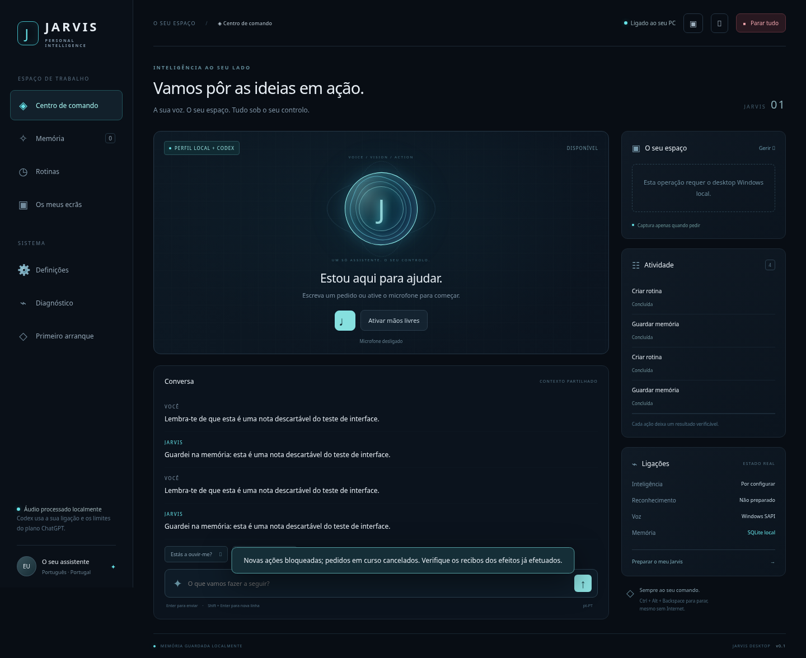

# Jarvis para Windows

Execute **INSTALAR.bat** uma vez e, depois, **INICIAR_JARVIS.bat**. Na aplicação, abra **Primeiro arranque** para selecionar microfone/voz, preparar o modelo e ligar a conta ChatGPT.

Requer **Windows 10/11 x64, Python 3.12 x64, Node.js LTS e Microsoft Edge WebView2 Runtime**. O instalador procura Python pelo launcher, PATH, registo e pastas habituais; o launcher `py` é opcional. Se faltar Python e existir WinGet, oferece a instalação oficial por utilizador. Não precisa de Docker, WSL, privilégios de administrador ou uma chave API para o perfil predefinido.

Esta é uma primeira implementação operacional, com serviço, ferramentas e interface reais. Foi desenvolvida e testada num ambiente Linux sem microfone ou desktop Windows. A voz, o controlo do seu PC e uma resposta autenticada do Codex **ainda precisam dos testes locais indicados na aplicação**. Consulte a [matriz de funcionalidades](docs/FEATURES.md) e o [relatório de testes](docs/TEST_RESULTS.md).



## Primeiro arranque

1. Extraia a pasta completa para um caminho à sua escolha; caminhos com espaços são suportados pelos scripts. Instale Python e Node pelas fontes oficiais se o instalador os indicar como ausentes.
2. Execute `INSTALAR.bat`. Instala versões fixadas, verifica hashes Python e usa o lockfile npm do Codex 0.163.0. Não descarrega modelos de linguagem nem ativa serviços pagos.
3. Execute `INICIAR_JARVIS.bat`. Em **Definições**, escolha o microfone e uma voz SAPI realmente enumerada no seu Windows. Guarde antes de preparar o modelo STT.
4. Clique **Preparar modelo STT**. `base` é multilingue, CPU/int8 por omissão, aproximadamente 145 MiB. `tiny` (~75 MiB) e `small` (~465 MiB) são alternativas; estes tamanhos são estimativas de descarga, não medições no seu PC. A qualidade e a latência em pt-PT ficam por medir. CUDA só deve ser selecionado com GPU e bibliotecas compatíveis.
5. Clique **Ligar ChatGPT**, conclua o fluxo oficial no browser e use **Testar resposta real do modelo**. O catálogo não comprova acesso: o modelo só fica verificado após completar um turno. O perfil dedicado usa o armazenamento de credenciais do sistema no Windows, sem copiar tokens de outras aplicações.
6. Em **Os meus ecrãs**, atualize a disposição e atribua nomes. Autorize ações e capturas apenas nos âmbitos que pretende usar. Faça os testes com Bloco de Notas e ficheiros descartáveis.

O reconhecimento é local. O Codex precisa de Internet e recebe o pedido e as notas relevantes incluídas como contexto. As imagens só são anexadas quando as seleciona explicitamente e autoriza o envio. ChatGPT Plus não fornece utilização ilimitada nem inclui automaticamente os custos das APIs de voz.

## Conversar e agir

Se aparecer «Não foi encontrado um Python 3.12 x64», escolha **S** na oferta WinGet do instalador atualizado. Em alternativa, use o [instalador oficial Python 3.12.10 x64](https://www.python.org/ftp/python/3.12.10/python-3.12.10-amd64.exe), escolha **Install Now**, feche a consola anterior e execute `INSTALAR.bat` novamente. Não selecione instalação para todos os utilizadores. A deteção também funciona sem instalar o launcher.

- Mantenha o botão do microfone premido para falar; solte para consolidar o pedido. As transcrições parciais não executam ações.
- Mãos livres requer auscultadores confirmados. A palavra «Jarvis» é reconhecida localmente pelo Whisper e abre uma janela de conversa de 30 segundos; não existe ainda um detector dedicado leve validado no seu hardware. O microfone continua aberto durante a resposta para permitir interrupção.
- Com colunas, use premir para falar. O cancelamento de eco acústico não está implementado/validado; uma comparação de texto com a resposta anterior é apenas uma proteção adicional. Não se anuncia suporte validado a mãos livres com colunas.
- Diga «Pára», prima **Parar tudo** ou use **Ctrl+Alt+Backspace** no Windows. A paragem bloqueia novas ações, interrompe áudio/inferência e cancela tarefas canceláveis. Uma chamada nativa já iniciada pode produzir efeito; nesse caso o recibo fica por verificar. Prima **Retomar Jarvis** para continuar.
- «Lembra-te de que prefiro respostas curtas em português de Portugal» grava uma nota real. «O que te pedi para recordar?» consulta-a sem invocar o Codex.
- «Abre o Bloco de Notas», «Abre a calculadora» e «Lista as janelas» têm percursos locais. Pedidos complexos usam as ferramentas estruturadas do Codex, após login.
- Ficheiros e documentos só podem ser criados/lidos/movidos nas pastas autorizadas. Criação não substitui ficheiros existentes. Word usa `python-docx` e reabre o resultado para verificar o conteúdo.

As ferramentas de desktop suportam abrir aplicações, observar/focar/organizar janelas, ler acessibilidade, escrever no controlo editável focado, área de transferência, volume e comandos multimédia. Resultados de multimédia ou abertura de URL sem estado observado ficam **por verificar**. Não há shell livre nem cliques por imagem ativados antes da validação de DPI.

## Dados, memória e rotinas

Os dados ficam em `%LOCALAPPDATA%\JarvisPT`, fora do código. `settings.json` não contém segredos; `memory.sqlite3` guarda notas, mensagens, tarefas, rotinas e métricas. Para mudar a localização, defina `JARVIS_DATA_DIR`. Faça uma cópia desta pasta com a aplicação fechada para recuperação. Não partilhe o diretório `codex-profile` nem `instance.json`.

A pesquisa usa SQLite FTS5 com atualização imediata, fontes e UUIDs estáveis. A galáxia representa relações explícitas `[[Título]]`; não inventa ligações ou notas. Pode editar, exportar e apagar notas. A importação de Markdown/texto é limitada às pastas autorizadas e conserva a origem.

As rotinas usam Europe/Lisbon, incluindo horário de verão e deduplicação persistente. Precisam do PC e do processo ligados. Execuções perdidas há mais de 15 minutos são registadas como bloqueadas e não são repetidas. Depois de um reinício, tarefas interrompidas não são repetidas automaticamente. A aplicação não instala arranque automático nem tarefas Windows sem pedido.

## Opções adicionais

- **Fish Audio**: execute `INSTALAR_OPCIONAIS.bat` e `CONFIGURAR_FISH.bat`. A chave é pedida com entrada oculta e guardada no Gestor de Credenciais do Windows. A interface pode consultar saldo API e vozes; não confunde créditos do site com acesso à API. Escolha modelo/voz, confirme as condições de utilização e aceite os custos antes de ativar. Streaming PCM com cancelamento está implementado, mas não foi testado com uma conta real.
- **Síntese OpenAI**: `CONFIGURAR_OPENAI.bat`; modelo e voz são configurados explicitamente segundo o acesso da sua conta API. É síntese oficial `/v1/audio/speech`, não Realtime nem uma voz privada do ChatGPT. Os custos e limites são próprios. Realtime/GPT-Live não foram implementados sem documentação/acesso verificável.
- **Offline**: o adaptador Ollama só lista/usa modelos já instalados. Não descarrega modelos. Este perfil oferece conversa e memória; imagens e ferramentas complexas não estão validadas neste percurso. Sem um modelo local disponível, não existe raciocínio offline.
- **Inspeção de sites**: `INSTALAR_NAVEGADOR.bat` prepara o Chromium do Playwright. A recolha começa antes da navegação, usa um contexto novo, fecha-o no fim e guarda um relatório com fontes na memória. Distingue banners literais de inferências e não afirma conhecer o servidor. REA 6.7.0 foi avaliado, mas não está integrado; o coletor identifica-se como Playwright. Web pública pode exigir destinos permitidos na rede.

## Desenvolvimento e validação

```sh
uv sync --frozen --extra dev --extra desktop --extra web --extra online
uv run pytest -q
uv run ruff check jarvis tests scripts
uv run python -m jarvis --headless
uv run python -m scripts.benchmark
```

No Linux, o serviço e os testes independentes de hardware funcionam; áudio nativo requer PortAudio, e SAPI/automação Windows ficam indisponíveis. Para verificar a interface num serviço já iniciado, indique `JARVIS_INSTANCE` e, se necessário, `JARVIS_CHROMIUM`, e execute `python -m scripts.browser_check`.

`DIAGNOSTICO.bat` conserva a consola aberta. `PARAR_JARVIS.bat` termina apenas a instância Jarvis autenticada. O modo compacto e o painel auxiliar usam o mesmo serviço e o mesmo áudio.

Não foi produzido nem testado um `.exe` Windows neste ambiente. Os scripts entregam um processo reproduzível a partir do código; a [verificação Windows](.github/workflows/windows.yml) pode ser executada manualmente no GitHub, depois de guardar o projeto no repositório. Não substitui o teste do seu microfone e dos seus monitores.

Fontes, decisões e licenças: [SOURCES.md](docs/SOURCES.md). Estado detalhado: [PROGRESS.md](docs/PROGRESS.md).
